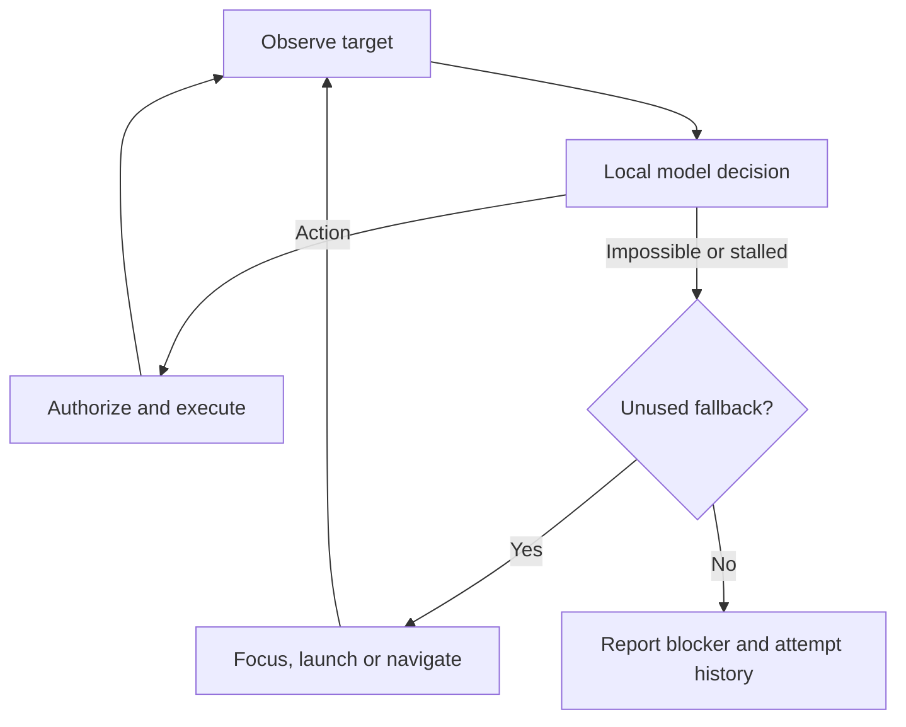

# GhostOS 1.1: navigation, responsive UI and voice

The worker now treats a focus problem as a recoverable navigation state. A model
verdict alone cannot skip the fallback ledger. The GUI owns presentation, the
worker owns computer control, the supervisor owns lifecycle, and an independent
indicator remains visible while the desktop window is minimized.

| Component | Change |
| --- | --- |
| `agent/windows_apps.py` | Explicit app aliases, native window enumeration, verified focus/maximize, App Paths discovery and installed-app launch; gated Windows Search fallback |
| `agent/recovery.py` | Finite, auditable fallback ledger; no command/submission replay |
| `agent/worker.py` | App preflight, recovery before impossible, model retries, UIA-to-vision fallback and separate failure states |
| `agent/runtime.py` | Nonblocking launch, startup cancellation, guaranteed supervisor cleanup, speech event routing and indicator health checks |
| `ui/activity_border.py` | Separate click-through indicator process, per-monitor geometry, capture exclusion where supported |
| `ui/app.py`, `widgets.py` | Vector GhostOS logo, Apple-inspired dark layout, settings beside Send, waveform and automatic voice submission |
| `ui/trajectory_view.py` | Bounded log batches and latest-frame background decoding/scaling |
| `agent/voice.py` | WebRTC endpoint detection, cached local Whisper, cancellable SAPI queue, calm defaults and privacy-preserving narration |
| `ui/settings_view.py` | Installed voice selection/preview, narration, pause duration and inference budgets |
| `ui/dashboard.html` | Matching visual identity, meaningful start/stop logs, stable approval cards and incremental log rendering |



Recovery does not bypass permission denial, UAC or stop/deadline limits. App names
are resolved from the user's goal and a known-app catalog. The app never silently
installs Chrome or enables browser remote debugging. Playwright uses an isolated
profile unless a loopback CDP endpoint is explicitly configured.

Voice recording begins only after pressing **Speak**. It ends on a configurable
silence window, then transcribes locally and submits under the current permission
tier. Empty, cancelled or duration-limited recordings cannot become commands.
Narration reacts to authorized `EXECUTING` events and never speaks field values
or script bodies. The queue coalesces fast steps rather than delaying execution.

New default configuration fields (existing settings load without migration):

```json
{
  "narrate_actions": false,
  "speech_voice": "",
  "speech_rate": 160,
  "speech_volume": 0.85,
  "vad_silence": 0.9,
  "voice_max_seconds": 45,
  "context_tokens": 8192,
  "prediction_tokens": 512,
  "browser_channel": "msedge",
  "screenshot_width": 1024
}
```

Smaller images/output reduce work; the actual speedup depends on model and GPU.
Windows SAPI voice quality depends on installed voices. The calm default prefers
Zira, otherwise the system voice. A native overlay may be hidden by secure
desktops or exclusive fullscreen games; no input injection workaround is used.

API references: [Qt window flags](https://doc.qt.io/qt-6/qt.html#WindowType-enum),
[Windows display affinity](https://learn.microsoft.com/en-us/windows/win32/api/winuser/nf-winuser-setwindowdisplayaffinity),
[WebRTC VAD](https://github.com/daanzu/py-webrtcvad-wheels),
[pyttsx3 event loops](https://pyttsx3.readthedocs.io/en/latest/engine.html).
